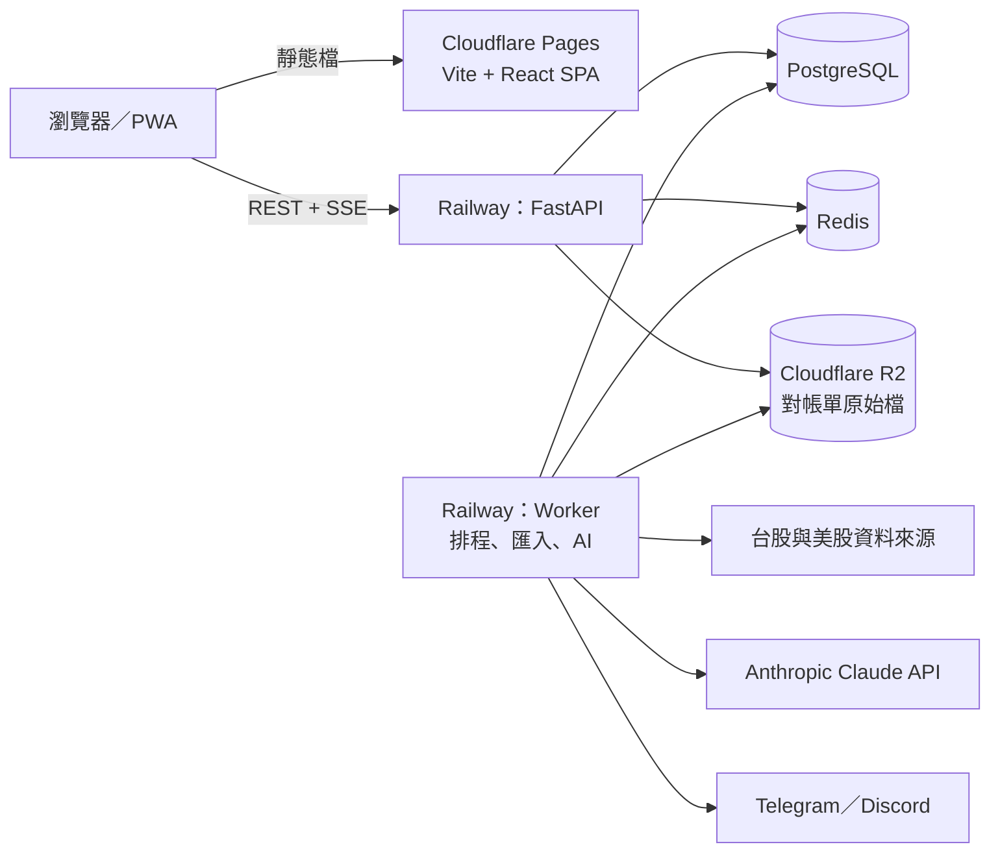

# Forliosa 產品需求規格

> 版本：v0.1 草稿（2026-11-11）
> 來源：與產品負責人的需求討論，以及 [`reports/台股 AI 開源投資管理平台.md`](../reports/台股%20AI%20開源投資管理平台.md) 的研究結論。
> 這份文件是開發起點，之後每個重大決定改動都要回來更新。

## 1. 產品定位

Forliosa 是一個**以台股為主的投資管理 web app**，結合三件事：

1. **持倉帳本與績效**：像 Google Finance 的 portfolio，但正確處理台股的除權息、配股、零股、手續費和證交稅。
2. **個股資訊**：像 Yahoo 股市的個股頁，包含報價、K 線、本益比與股價淨值比河流圖、籌碼、財務、股利。
3. **AI 分析**：對話助理、持倉健檢、盤後報告推播、個股深度報告。

另外有**親友群組**，讓家人朋友在自己同意的範圍內互相分享績效與持股。

### 使用對象與階段

| 階段 | 使用者 | 影響 |
|---|---|---|
| 現在 | 產品負責人＋家人朋友（少量帳號，非商業） | 免費資料源可用；AI 費用由產品負責人統一支付 |
| 未來（可能） | 公開註冊、商業化 | 資料源要換成可商用授權；需要法律諮詢；可能改為付費方案 |

## 2. 硬性原則

這些原則從第一天就要遵守，避免日後商業化時重寫：

1. **多使用者架構**：每筆資料都綁定使用者，所有查詢都經過權限檢查。
2. **不複製 AGPL 程式碼**：Wealthfolio、Ghostfolio、Sure、AssetPilot、shioaji-pro-app 只參考資料模型、計算規則與介面設計，自己重寫。MIT／Apache-2.0 專案可以重用，但要保留授權聲明（見第 12 節）。
3. **資料來源可替換**：所有市場資料都經過一層 provider 介面。商業化前要換成有商用授權的來源，業務邏輯不改。
4. **不下單、不串券商 API**：包含永豐 Shioaji。持倉同步一律靠對帳單匯入。
5. **AI 只提供分析，不保證結果**：所有 AI 輸出都附免責聲明；商業化前要先確認是否涉及《證券投資信託及顧問法》的投顧業務。
6. **使用者控制自己的資料曝光**：分享功能預設最保守，只有使用者主動打開的項目才會給別人看到，AI 群組週報也只能使用這些資料。

## 3. 範圍

### 資產類別

| 資產 | 第一版 | 備註 |
|---|---|---|
| 台股上市（`.TW`）、上櫃（`.TWO`）股票 | ✅ | 含零股 |
| 台股 ETF | ✅ | 證交稅 0.1% |
| 美股（股票、ETF） | ✅ | 多幣別，依中央銀行〈銀行間新臺幣對美元收盤匯率〉換算成台幣（成本用交易日匯率、市值用最新匯率；沒有匯率資料時固定 31.5 並說明） |
| 台指期、個股期、選擇權 | 第二階段 | 帳務邏輯不同（保證金、契約乘數、每日結算），只能靠期貨商對帳單匯入 |
| 興櫃、權證 | 待評估 | |

### 幣別

- 基準幣別：新台幣（TWD）。
- 美股以美元記帳，績效同時顯示原幣與台幣兩種視角。

## 4. 功能需求

標示：**M1–M5** 為第一版的開發里程碑（見第 11 節），**P2** 為第二階段。

### 4.1 帳號與券商帳戶（M1）

- 登入：**Discord 帳號**（OAuth；產品負責人 2026-11-12 決定，開放任何有 Discord 帳號的人註冊，AI 額度照每人限制）。第一次登入時以 Discord
  回報**已驗證**的 email 建立帳號（或連結到同 email、還沒連結 Discord 的既有帳號）；顯示名稱預設取 Discord 名稱，可在設定修改（群組裡顯示的就是它），
  頭像用 Discord 的。不儲存 Discord 的 token。開發環境另有開發登入。介面與規則見 `docs/api-contract.md`「分享（M5）」→「登入」。
- 每個使用者可以有多個**券商帳戶**（例如「永豐－一般」「國泰－複委託」），每個帳戶設定：
  - 券商名稱、幣別
  - 手續費折扣（例如 2.8 折）、最低手續費（整股與零股可分開設定）
  - ~~追蹤模式：**逐筆交易**或**只記持股**（參考 Wealthfolio 的 `TRANSACTIONS`／`HOLDINGS` 模式）~~（產品負責人 2026-11-14 決定取消：像 Google 財經，每一筆買進都要記日期；舊的快照轉成快照日的買進）。
    每個帳戶都逐筆記交易。

### 4.2 持倉輸入（M1、M3）

兩種方式都要支援，可以混用：

| 方式 | 里程碑 | 說明 |
|---|---|---|
| 手動逐筆輸入交易 | M1 | 績效最精確（TWR、XIRR）。每一筆買進都有日期；選了日期，價格欄下顯示那天的收盤價，點一下填入 |
| ~~只輸入目前持股與均價~~ | ~~M1~~ | 2026-11-14 取消（產品負責人決定：每一筆買進都要記日期）。想快速上手就用持股的買進日與均價記一筆買進 |
| 匯入券商對帳單 | M3 | 三層匯入，見下方 |

**三層匯入**（目標：盡量支援所有券商）：

1. **券商專屬解析器**：讀各家匯出的 Excel、CSV、PDF。先做家人朋友實際使用的券商，需要先收集對帳單樣本。
2. **通用欄位對應精靈**：遇到不支援的格式，讓使用者把欄位對應到「日期、代號、買賣別、數量、價格、手續費、稅」。
3. **AI 解析**：任何格式（含 PDF、截圖）交給 AI 抽出交易，**使用者逐筆確認後才入帳**。

**匯入共通要求：**

- 預覽畫面標出「新增、重複、可能有誤」三種狀態；以券商委託書號或（日期＋代號＋數量＋價格）判斷重複。
- 密碼保護的 PDF 對帳單：使用者上傳時輸入密碼，伺服器不保存密碼。
- 原始檔存放在物件儲存（Cloudflare R2）並加密，解析完成後預設 30 天自動刪除。
- **對帳**：使用者上傳券商的庫存快照後，系統比對帳本與快照，標出差異（例如漏記配股、漏記減資）。

### 4.3 交易類型與台股稅費（M1）

交易類型：

| 類型 | 說明 |
|---|---|
| 買進、賣出 | 支援整股、零股；介面可用「張」或「股」輸入（1 張＝1,000 股） |
| 現金股利 | 自動帶入二代健保補充保費；台股由系統在除息日自動入帳（見下方「股利自動入帳」） |
| 股票股利（配股） | 每 1 元股票股利配 0.1 股（面額 10 元）；台股由系統在除權日自動入帳 |
| 分割、減資、合併 | 調整股數與成本 |
| 現金存入、提出 | 計算 TWR、XIRR 需要 |
| 手續費、稅（單獨記錄） | 例如補繳或退費 |
| 利息 | 例如券商交割戶利息 |

自動計算規則（使用者可手動覆寫）：

| 項目 | 規則 |
|---|---|
| 手續費 | 成交金額 × 0.1425% × 帳戶折扣，低於最低手續費時以最低計（預設 NT$20；零股最低依帳戶設定） |
| 證交稅（賣出） | 股票 0.3%、ETF 0.1%、當沖 0.15%（當沖減半優惠實施至 2027-12-31） |
| 二代健保補充保費 | 單筆股利所得 ≥ NT$20,000 時，扣 2.11%；資本公積發放的現金一般不屬股利所得，依官方股利決議自動排除（產品負責人 2026-11-12） |
| 股利所得稅 | 不計入績效；在「股利報表」提供兩種算法試算：8.5% 可抵減（每戶上限 NT$80,000）或 28% 分開計稅 |

計算公式參考 muzsor/twstock-calc（MIT）與 AssetPilot（AGPL，只看規則不複製程式碼）。

#### 股利自動入帳（產品負責人 2026-11-12）

**為什麼要記股利**：除息（權）那天股價會往下調，股利則進了使用者的銀行帳戶。Forliosa 看不到銀行，如果不記股利，帳上只看得到股價下跌，
股利就被算成了虧損。例：持有 0056 十張、每股配 2 元，除息日帳上少了約 2 萬元，看起來像虧了 5%；和含息的基準（報酬指數）比較也不公平。
但使用者不應該需要自己去記，所以台股股利由系統**依規則自動記帳**（不是 AI 判斷，也不需要使用者確認）。

**規則**

- 對象：台股上市、上櫃的現金股利與股票股利（配股），依證交所、櫃買公布的除權除息預告。金額為 0 或還沒公告的先不記，公告後自動補上。
- 美股：目前沒有可商用的股利資料，仍由使用者自己記。
- 股數：除息（權）日**前一天收盤**時這個帳戶持有的股數。前一天（含）以前買的算；除息日當天才買的不算；除息日當天賣掉的仍算。
- 日期：記在除息（權）日，讓股價下跌和股利在同一天抵銷，報酬走勢不會在除息日到發放日之間出現假跌。發放日已公告時寫在備註。
  除息日還沒到的不記（「即將除權息」照常提醒）。
- 金額：和手動記一筆股利的算法相同。現金股利 = 股數 × 每股股利，元以下捨去，二代健保補充保費自動估算（資本公積發放的部分排除）；
  配股依面額 10 元換算配發股數，不足一股折付現金。
- ~~「只記持股」的帳戶：只記快照日之後的除息日~~（2026-11-14 取消「只記持股」）。
- 只涵蓋開始存檔之後的除息日；更早的股利請使用者自己記（或匯入）。示範資料不會產生股利。

**使用者自己記的優先**：同一帳戶、同一檔已經有自己記的同類股利（手動、匯入或簽名的 AI 草稿），日期在除息日起 120 天內（例如記在發放日），
系統就不另外記，避免重複；刪掉自己記的那筆，自動的會回來。

**使用者可以改、可以刪**

- 交易紀錄裡自動記的股利標「自動」。
- 修改：改過的那筆變成使用者自己的版本（例如依券商實收金額調整二代健保），系統之後不再覆蓋。
- 刪除：同一次股利之後不會再自動產生；要記回來就自己新增一筆。
- 使用者補記或刪除較早的交易（例如補一筆除息前的買進），自動記的股數與金額會跟著重算。重算會讓帳目矛盾時（例如配到的股數之後已經賣掉），
  這次修改不會儲存，並說明原因。

帳本、績效、股利收入、已出清紀錄、股利發放提醒都直接使用這些交易，不另外計算。

### 4.4 績效計算（M1）

- 指標：
  - **TWR**（時間加權報酬）：比較投資能力，排除資金進出影響。
  - **XIRR／MWR**（金額加權年化報酬）：反映自己實際賺多少。
  - 已實現損益、未實現損益、股利收入（每月、每年）。
  - 最大回撤、波動度。
- 基準比較：發行量加權股價**報酬**指數（含息）、0050，或任選一檔標的。
- 資產配置：依市場、產業、題材（題材資料來自 shioaji-data）、幣別、帳戶。
- 成本法：預設移動平均成本（台灣券商常用），可切換 FIFO。
- **避免重複計算股利**：價格一律用未還原的收盤價，股利另以交易記錄；不可同時用還原價又記股利。台股股利由系統在除息（權）日自動記錄（見 4.3「股利自動入帳」）。

參考：StackWorth（MIT，台幣計價的 XIRR 與 TWR）、Portfolio Performance（TTWROR、IRR 的定義）、Wealthfolio（TWR＋MWR，注意它有台幣使用者回報的 TWR 錯誤 #1425、#1414、#1473，要寫測試避開同類問題）。

### 4.5 行情（M2）

| 市場 | 盤中 | 盤後 |
|---|---|---|
| 台股 | 每 30–60 秒批次輪詢「所有使用者持股＋自選股」的聯集，來源為證交所基本市況報導網站的公開查詢端點；Yahoo 為備援 | 收盤後寫入日線：TWSE／TPEx OpenAPI、shioaji-data `market/daily.json` |
| 美股 | 延遲報價，美股交易時段輪詢 | 日線 |

- 報價透過 SSE 推送到瀏覽器（參考 Shioaji 的 SSE 做法）。
- 批次請求、限速、失敗退避，避免被封鎖（參考 TWSEMCPServer 的 0.5 秒間隔、twstock 的每 5 秒 3 次）。
- ⚠️ 這個公開端點不是官方 API；證交所的即時行情對外提供需要簽約付費。**商業化前一定要換成有授權的行情來源。**

### 4.6 個股頁（M2）

頂部：代號、名稱、現價、漲跌、成交量、加入自選、問 AI。

| 分頁 | 內容 | 資料來源 |
|---|---|---|
| 總覽 | 關鍵數字、**相關股票**（4 格：比較基準／富櫃五十成分股、關係企業、同業；ETF 頁是同指數、同類型 ETF；少於 2 格不顯示）、**關於〈公司〉**（維基百科節錄或 AI 依官方資料寫的 2–3 句簡介；產業別、成立日期「成立 N 年」、上市／上櫃日期、總部、網站、實收資本額、董事長、總經理、簽證會計師事務所、股務代理，附來源與資料日期） | 證交所／櫃買〈公司基本資料〉〈董監事持股餘額明細〉、櫃買〈富櫃五十成分股〉、集保〈集保股東戶數〉、中文維基百科（CC BY-SA 4.0 節錄）、Wikidata（CC0）；美股 SEC submissions |
| K 線 | 日／週／月 K、均線、成交量、常用指標 | 日線資料庫 |
| **估值** | 本益比河流圖、股價淨值比河流圖、殖利率走勢（對標 Yahoo 股市「價值評估」頁）；EPS ≤ 0 時本益比區間留白並說明原因 | TWSE `BWIBBU`、TPEx 本益比、FinMind `TaiwanStockPER` |
| 籌碼 | 三大法人買賣超與外資持股（**只有上櫃**；上市股票不顯示逐檔三大法人，外資持股只有名列證交所「外資及陸資持股前 20 名」的股票才顯示持股比與名次，其他是空狀態並說明原因，可直接問 AI「最近外資對這檔的動向？」，AI 上網搜尋新聞並附來源與日期）、融資融券、集保股權分散 | TPEx OpenAPI（法人、外資持股）、TWSE OpenAPI `MI_QFIIS_sort_20`（上市外資持股前 20 名）、TWSE／TPEx OpenAPI（融資融券）、TDCC |
| 財務 | 月營收（年增、月增）、季 EPS、毛利率、三大報表重點 | shioaji-data（月營收 2023-10 起、季報 2023Q1 起），更早的歷史用 FinMind |
| 財務（美股） | 季報／年報（依公司會計年度，例如 FY2026Q1）：營收、毛利率、營業利益率、淨利率、稀釋 EPS、總資產、負債比、營業與自由現金流；金額單位美元。沒有月營收 | SEC EDGAR XBRL companyfacts（美國政府公開資料，2026-11-12 起） |
| 事件（美股） | SEC 申報：10-K 年報、10-Q 季報、8-K 重大事件（依申報項目標示，例如營運結果與財務狀況＝財報新聞稿），連到 sec.gov 原文；持有時年報與季報算「我的」 | SEC EDGAR submissions |
| 股利 | 歷年現金與股票股利、殖利率、填息天數 | TWSE 除權息資料、FinMind |
| 新聞 | 「新聞報導」：媒體原標題＋媒體名稱＋時間＋原文連結（不轉載內文、不放圖片，有下架封鎖清單）；「公告」只放官方重大訊息與證交所新聞 | GDELT DOC 2.0（為主）、AI 網路搜尋（補缺，每月上限 US$30）、SearXNG（預設關）；Yahoo股市 RSS 只在 personal |
| AI 報告 | 最新的個股深度報告與歷史版本 | 本系統 |
| 我的交易 | 我在這檔的交易、成本、損益 | 本系統 |

**法人觀點**（總覽裡預設收合的區塊，只有個股；2026-11-12 產品負責人決定，後端已實作）：使用者展開後按「查詢近期法人觀點」，AI 上網搜尋近 90 天的報導，列出第三方機構已公開的評等與目標價，最多 5 筆、依報導日期新到舊，每筆附報導標題、日期與原文連結。網址必須是這次搜尋實際找到的報導、日期由搜尋結果核對，核對不到的不列；只寫「美系外資」「外資券商」這類沒有機構名稱的不列，同一家機構（大摩＝摩根士丹利）只列最新一筆。同一檔同一個交易日全體使用者共用一份，24 小時後刪除；觸發查詢的人算一題 AI 額度，其他人看同一份不計。AI 自己不給目標價，不算平均、上漲空間，不排名，不寫買賣提示；上方固定顯示「以下為媒體報導的第三方觀點，可能不完整或未經授權轉載，非 Forliosa 建議。」查不到時 10 分鐘後可以再查（收合再展開卡片就會重新讀取）。

### 4.7 AI 功能（M4）

四項功能共用一層 **AI 工具**（tool use），讓模型可以查詢：

- 使用者自己的持倉、交易、績效（嚴格限定在目前使用者或其被授權的範圍）
- 個股報價、日線、估值、籌碼、財務、股利、新聞
- shioaji-data 的公司資料與產業鏈題材（公司 Markdown 頁可直接當背景資料）

| 功能 | 觸發 | 輸出 | 延遲要求 |
|---|---|---|---|
| **AI 對話助理** | 使用者提問；可在個股頁開啟並自動帶入該股 | 串流文字回答，附引用的數據 | 即時（串流） |
| **持倉健檢** | 使用者按鈕觸發，或每週自動 | 結構化報告：集中度、產業與題材曝險、風險、與大盤比較、調整建議 | 數十秒內，背景執行 |
| **盤後報告推播** | 每個交易日收盤後排程 | 持股的漲跌原因、法人動向、新聞重點、異常變動 → Telegram／Discord＋報告頁 | 收盤後一段時間內送達即可 |
| **個股深度報告** | 使用者在個股頁請求 | 多代理人報告：基本面、技術面、籌碼、新聞四位分析師 → 多空辯論 → 總結與風險 | 數分鐘，背景執行，完成後通知 |

**個股深度報告的做法**：自己實作由程式控制流程的多代理人工作流，不直接套用 TradingAgents 套件。角色分工與提示詞參考 TradingAgents（Apache-2.0），但資料改接本系統的台股資料層，補上它缺的月營收、法人與中文新聞，輸出固定為繁體中文。

**LLM 供應商**：預設 Anthropic Claude，程式內保留供應商抽象層。

**成本控制**（AI 費用由產品負責人統一支付，第一版就要做）：

1. **共用快取**：同一檔股票同一天的深度報告所有使用者共用；盤後報告的大盤與個股摘要共用，只有「與你持股相關」的部分個別產生。
2. **Prompt caching**：系統提示、工具定義、公司背景資料這些不變的內容放在前面，讓重複請求命中快取。
3. **批次處理**：盤後報告、群組 AI 週報這類不急的工作改用 Message Batches API（官方標示費用為一般請求的 50%）。
4. **每人額度**：每日對話次數、每月深度報告與健檢次數設上限（數字待定），用量記錄到資料庫並在設定頁顯示。
5. **依功能調整推理強度（effort）**：對話用較低、深度報告用較高。是否改用不同等級的模型，要先建立評估集量測品質後，由產品負責人決定。
6. **結構化輸出**：健檢與深度報告用 JSON schema 固定格式，前端直接渲染成卡片，也方便快取與比對歷史。

**AI 輸出的共通要求**：

- 所有數字必須來自工具查詢結果，不讓模型憑記憶給數字；回答中標示資料日期。
- 處理模型拒答（`refusal`）的情況，顯示友善訊息。
- 每份報告附免責聲明：「AI 分析僅供參考，不構成投資建議」。

### 4.8 分享（M5）

> 範圍與決定（產品負責人 2026-11-12，見 `PRODUCT.md`「分享（M5）範圍」）：照本節一次做完；介面與規則的定案版本在 `docs/api-contract.md`
> 「分享（M5）」，後端實作細節在 `apps/api/CONTRACT_NOTES.md`「2026-11-12 分享（M5）第一批」與「第二批」。

#### 授權查看（一對一）

- 使用者可以授權另一位使用者**唯讀**查看自己的資產，範圍可選「全部帳戶」（含之後新增的）或「指定帳戶」。**只能授權給和自己同在至少一個群組的成員**
  （直接從成員中選，不產生邀請連結）；之後不再同群組時授權不會自動撤銷。
- 隨時可撤銷（立即生效），被授權者也可以自己移除；被授權者看到的畫面右上角標示「正在查看 ○○ 的資產（唯讀）」。
- 查看模式只能讀帳本相關的頁面（帳戶、持倉、績效、交易、出清、本週事項、個股的我的部位與事件），而且只算授權範圍內的帳戶；不能寫入，也不能用 AI、
  自選、群組、設定。顯示偏好用查看者自己的，成本法與基準用授權者的。

#### 親友群組（多對多）

- 建立群組、以有期限的邀請連結加入（24 小時或 7 天、單次或多次，可撤回）；角色分為擁有者（一位，要先轉移才能離開）、管理員、成員。
  每個群組最多 50 位成員，每人最多加入 20 個群組。
- **每位成員在每個群組各自決定要分享什麼**（四個開關，預設只開第一個；另有「附上價格」與「推播」兩個附屬開關）。**接受邀請前先選分享**：
  加入畫面先顯示開關讓本人確認。離開群組時分享設定刪除，重新加入時重新選。

| 分享項目 | 預設 | 內容 |
|---|---|---|
| 報酬率（只有 %） | 開 | 今日、本月、今年報酬率，另外顯示總報酬率（含股利） |
| 持股清單與權重 | 關 | 持有哪些股票、各佔幾 %（四捨五入到 1%），不含股數與金額 |
| 實際金額與損益 | 關 | 市值、今日損益金額、總損益 |
| 交易動態 | 關 | 「○○ 買進 2330」（同一人同一天同一檔同方向合併成一則）；打開時也會顯示最近 90 天的買賣（開關旁明講）。可另外選擇是否**附上價格**；**沒有理由欄位** |
| 推播 | 關 | 把我開放的內容送到群組的 Discord／Telegram 頻道（要本人另外打開） |

- 沒開放的內容完全不出現（不顯示「某某沒分享」）；群主可以關掉排行（改依加入順序、不顯示名次）。
- 群組互動：
  - **排行榜**：今日、本月、今年報酬率排名（同分並列），所有成員與大盤共用同一個期間起點；可對照大盤（發行量加權股價報酬指數）與 0050。
    總報酬率每人都顯示但不排名。
  - **留言與表情反應**：對交易動態、排行（每天一串）與週報留言；表情固定六個（👍🎉🔥😮😢👀）。關掉分享或離開群組後，那些動態與底下的留言立即看不到；
    交易刪除時那則動態與留言一起刪除。
  - **群組 AI 週報**：每週總結群組表現、共同持股與產業重疊；**只能使用每位成員對該群組開放的資料**，AI 只看到匿名代號，不點名個人。
  - **推播到群組頻道**：群組動態與週報送到你們的 Discord 頻道（webhook）或 Telegram 群組；頻道只有群主能設定，所有成員都看得到推播到哪裡；
    只送有打開「推播」的成員的內容。
- 實作要求：所有群組畫面與 AI 週報都只讀取「分享投影」（依每位成員在該群組的設定過濾後的資料），不直接讀取原始帳本。
- 實作進度（2026-11-12）：後端全部完成——登入、授權查看、群組（成員、邀請、分享設定、排行、持股重疊、交易動態、留言、表情）、群組 AI 週報、
  Discord／Telegram 頻道推播。前端還要接上週報與頻道設定。

### 4.9 推播（群組頻道：M5 已完成；個人通知：之後）

| 管道 | 綁定方式 | 用途 |
|---|---|---|
| Telegram | 群主在 app 產生連結碼（10 分鐘、一次性），把本系統的 bot 加進 Telegram 群組，在群組裡傳 `/link 連結碼`；bot 回覆群組名稱確認 | Telegram 群組（M5）；個人通知（之後） |
| Discord | 群主貼上頻道的 webhook 網址；儲存前先送一則測試訊息，網址加密保存、畫面只顯示最後 4 碼 | 群組頻道（M5）；個人頻道（之後） |

**群組頻道（M5，已完成）**：每個群組各一個 Discord 頻道與一個 Telegram 群組，只有群主能設定，所有成員都看得到推播到哪裡。

- **交易動態**：只送有打開「推播」也打開「交易動態」的成員的買賣；交易建立 15 分鐘後才送（期間刪除或關掉就不送），只送最近三天（今天與前兩天）
  的交易，而且是頻道設定、本人打開開關之後新記的；同一筆交易只送一次，之後修改不重送。打開「附上價格」才附成交均價。
- **週報**：每週六 20:00 產生上週的群組 AI 週報，完成後推播；推播只有開了「推播」的成員的數字，AI 摘要只有在寫進摘要的每一位成員都開著推播時
  才附上。
- 訊息是純文字（不能 @所有人）；送不出去會重試 5 次；webhook 被刪掉或 bot 被移出群組時，頻道自動停用，群主重新設定即可。

**個人通知（之後）**：到價警示、漲跌幅警示、除權息前提醒、盤後報告、AI 報告完成。每一類都可以個別開關。

### 4.10 設定（M1 起逐步加入）

- 顯示：**紅漲綠跌**（預設，可切換為綠漲紅跌）、淺色／深色主題、以張或股顯示、數字縮寫（萬、億）。
- **隱私模式**：一鍵遮蔽所有金額與股數，方便截圖分享（參考 Shioaji Pro）。
- AI 額度與用量、通知設定、券商帳戶、資料匯出（CSV）、刪除帳號。

## 5. 資訊架構與 UI/UX

### 導覽

- **桌面**：左側欄（總覽、持股、交易、自選、績效、AI 助理、報告、群組、匯入、設定），頂部為全域搜尋（⌘K，可用代號或中文股名搜尋）。AI 助理是右側可展開的面板，在個股頁開啟時自動帶入該股。
- **手機**：底部五個分頁「總覽、持股、自選／搜尋、AI、更多」；AI 助理為全螢幕對話。
- 手機與桌面同等重要：每個頁面都要同時設計兩種版面。

### 視覺風格：混合型

- **首頁簡潔**：大數字、留白、卡片（接近 Google Finance）。
- **細節頁資訊密集**：持股、個股、交易、績效以表格與圖表為主（接近 Yahoo 股市與 Shioaji Pro）。
- 表格在手機上收合成卡片，只顯示關鍵欄位，點開看完整資料。

### 頁面清單

| 頁面 | 風格 | 重點 |
|---|---|---|
| **總覽（首頁）** | 簡潔 | 第一眼：**總資產與今日損益**；含股利的總損益；報酬走勢圖（1D／5D／1M／6M／YTD／1Y／全部，可疊加基準）；「AI 今日重點」卡；資產配置圓環圖；即將除權息提醒 |
| 持股 | 密集 | 代號、名稱、股數（X 張＋Y 股）、均價、現價、今日漲跌、市值、未實現損益、報酬率、佔比、AI 訊號；可依帳戶與市場篩選 |
| 個股頁 | 密集 | 見 4.6 |
| 交易紀錄 | 密集 | 清單、篩選、新增與編輯；交易前預估手續費與稅 |
| 自選 | 密集 | 自選清單、迷你走勢圖、排序、備註 |
| 績效分析 | 密集 | TWR、XIRR、已實現與未實現、股利收入、基準比較、回撤、配置 |
| AI 助理 | 對話 | 自由提問、建議問題、一鍵持倉健檢 |
| 報告 | 列表 | 盤後報告、健檢報告、個股深度報告的歷史 |
| 群組 | 混合 | 排行榜、交易動態與留言、成員、我的分享設定、AI 週報 |
| 匯入中心 | 精靈 | 上傳 → 辨識券商 → 預覽 → 確認入帳 → 對帳差異 |
| 設定 | 表單 | 見 4.10 |

### 台股介面細節

- 數字使用等寬數字（`font-variant-numeric: tabular-nums`），對齊小數點。
- 中文字型以思源黑體／Noto Sans TC 這類繁中字型為主，實際選擇由第 6 節的設計流程決定。
- 漲跌同時用顏色與符號（▲▼）表示，色弱使用者也能分辨。
- 空狀態要引導使用者：還沒有持股時，首頁顯示「匯入對帳單」或「輸入目前持股」兩個入口。

## 6. 前端設計流程：使用 Impeccable

前端所有頁面都要用 [Impeccable](https://github.com/pbakaus/impeccable)（Apache-2.0）協同設計與審查。

### 安裝（M0）

```bash
npx impeccable install --providers=claude --scope=project
```

- 安裝時接受 design hook（每次修改 UI 檔案時自動掃描常見的「AI 味」設計問題）。
- 把 `.claude/skills/impeccable`、hook 設定、`.impeccable/config.json`、`PRODUCT.md`、`DESIGN.md` 提交進 repo；`.gitignore` 加入 Impeccable README 列出的暫存檔規則。
- hook 會在模型核准流程之外執行，安裝後要先檢查 hook 內容。
- 遙測：Impeccable 會向 impeccable.style 取得視覺方向；是否關閉匿名遙測（`npx impeccable telemetry off`）由產品負責人決定。

> **目前狀態（2026-11-11）**：開發環境連不到 impeccable.style，`npx impeccable install` 失敗，因此改用 README 的「手動複製」方式，把 `.claude/skills/impeccable` 從 GitHub 版本（commit `c1e0e54`）複製進 repo，偵測引擎 0.1.22 可正常執行。
> design hook（`.claude/settings.json`）會修改 Claude Code 設定，需要產品負責人同意後才加入，內容見 `docs/questions-for-morning.md`。

### 每個頁面的流程

| 步驟 | 指令 | 產出 |
|---|---|---|
| 1. 專案初始化（一次） | `/impeccable init` | `PRODUCT.md`：以本文件為輸入 |
| 2. 規劃頁面 UX | `/impeccable shape <頁面>` | 寫程式前先定頁面結構與流程 |
| 3. 實作 | 一般開發 | 頁面程式碼（app 畫面一律直接寫程式，不先做圖稿） |
| 4. 建立設計系統 | `/impeccable document`、`/impeccable extract` | 前幾個頁面完成後產生 `DESIGN.md`，並把重複的樣式整理進設計系統 |
| 5. 審查 | `/impeccable critique <目標>`、`/impeccable audit <目標>` | 修完所有 P0、P1 才算完成 |
| 6. 收尾 | `adapt`（手機與桌面）、`harden`（錯誤、溢位、長股名、大數字）、`onboard`（空狀態與首次使用）、`clarify`（文案）、`polish` | 可上線的頁面 |

### 持續檢查

- CI 在每個 PR 執行 `npx impeccable detect --github`，掃描前端原始碼。
- 本機開發時也對 dev server 網址執行一次 `npx impeccable detect`，檢查對比度、字級這類需要渲染後才看得到的規則。
- 使用 live mode 時一律只在本機，並設定 `IMPECCABLE_LIVE_COPY_AGENT=chat`，避免它在背景啟動繞過權限檢查的 agent。

### 交給 Impeccable 的台股設計限制

紅漲綠跌、等寬數字、繁中字型、張／股並存顯示、萬／億縮寫、隱私模式遮罩、資訊密集表格在手機上的收合規則。

### UI 函式庫分工

選擇原則依 Emil Kowalski 的 `pick-ui-library` skill（`.claude/skills/pick-ui-library`）：每種需求只選一個函式庫，不手刻已有成熟方案的元件。產品負責人另外指定要參考的函式庫也都列在這裡。

| 需求 | 採用 | 備註 |
|---|---|---|
| 元件骨架（按鈕、表單、表格、卡片） | [shadcn/ui](https://ui.shadcn.com) | 元件複製進專案，可自由修改 |
| 無樣式、無障礙的基礎元件（對話框、選單、下拉、Popover） | [Base UI](https://base-ui.com) | shadcn/ui 設定為 Base UI 版本；pick-ui-library 的首選 |
| Base UI 沒有的元件 | [Radix](https://www.radix-ui.com) | 個案使用 |
| 通知 | [Sonner](https://sonner.emilkowal.ski) | 搭配 `ask-sonner` skill |
| 手機底部抽屜（新增交易、篩選） | [Vaul](https://vaul.emilkowal.ski) | ⚠️ 作者已標示不再維護（最後版本 1.1.2，2024-12），先用，持續觀察 |
| ⌘K 指令與股票搜尋 | [cmdk](https://cmdk.paco.me) | 支援中文股名 |
| 數字動畫（總資產、損益、報價跳動） | [NumberFlow](https://number-flow.barvian.me) | |
| 一般動畫 | [motion](https://motion.dev) | 簡單淡入淡出用 CSS 即可 |
| 績效、配置等一般圖表 | [recharts](https://recharts.org) | |
| K 線圖 | [lightweight-charts](https://github.com/tradingview/lightweight-charts) | 需標示 TradingView |
| 長清單（交易紀錄） | [Virtuoso](https://virtuoso.dev) | |
| 狀態（顯示偏好、隱私模式） | [zustand](https://zustand.docs.pmnd.rs) | 伺服器資料用 TanStack Query |
| className 組合 | clsx、cva | shadcn/ui 內建 |
| 視覺靈感與點綴元件 | [Beautiful UI](https://beautifului.dev)、[RareUI](https://rareui.in)、[Magic UI](https://magicui.design)、[Aceternity UI](https://ui.aceternity.com)、[21st.dev](https://21st.dev) | 只用在登入頁、首次使用引導、空狀態、群組排行這類展示性畫面；每個元件都要先確認授權，並通過 Impeccable 的 critique，避免花俏特效干擾閱讀數字 |

同一類需求只能用一個函式庫（例如通知只用 Sonner），採用新函式庫前要更新這張表。

Emil Kowalski 的其他 skills（`.claude/skills/`）在對應時機使用：`emil-design-eng`（整體設計與動畫原則）、`mobile-native`（手機網頁的原生感）、`break-ui`（用極端資料測試介面，例如很長的股名、上億的金額）、`animate`／`review-animations`（動畫）、`ask-sonner`（通知）。

## 7. 技術架構



| 層 | 選擇 | 理由 |
|---|---|---|
| 前端 | Vite＋React＋TypeScript、Tailwind＋shadcn/ui（Base UI）、TanStack Router＋TanStack Query、lightweight-charts（K 線）、recharts（績效與配置圖）；其餘函式庫見第 6 節「UI 函式庫分工」 | 整個 app 都要登入，不需要伺服器端渲染；部署成 Cloudflare Pages 的靜態網站最簡單。永豐 Shioaji Pro 也是 React＋Vite＋lightweight-charts，介面做法容易參考 |
| PWA | Service worker、可加到主畫面 | 手機體驗 |
| 後端 API | Python FastAPI、SQLAlchemy 2、Alembic、Pydantic | FinMind、資料處理與 AI 工作流都在 Python 生態系 |
| 背景工作 | Redis 工作佇列（arq 或 Celery）＋排程 | 盤中輪詢、盤後抓資料、匯入解析、AI 報告、推播 |
| 資料庫 | PostgreSQL（Railway 託管） | 交易帳本需要交易一致性 |
| 快取 | Redis | 盤中報價、AI 共用快取、限速 |
| 物件儲存 | Cloudflare R2 | 對帳單原始檔（加密、30 天自動刪除） |
| 即時推送 | SSE | 比 WebSocket 簡單，單向推送足夠 |
| 登入 | 後端自管 session（httpOnly cookie）＋Discord OAuth | 前後端放在同一個主網域下（例如 `app.` 與 `api.`），cookie 才能共用 |
| 部署 | 前端：Cloudflare Pages；後端：Railway（API、Worker、PostgreSQL、Redis 四個服務） | 產品負責人的選擇 |
| Monorepo | `apps/web`（前端）、`apps/api`（FastAPI）、`apps/worker`、`packages/`（共用型別與 API schema） | 前後端型別由 OpenAPI 產生，避免不同步 |

### 安全

- 金額、持股、交易屬於敏感個資：傳輸全程 HTTPS，資料庫與 R2 加密，後台存取留稽核紀錄。
- 每個 API 都要經過「本人或被授權者」的權限檢查；群組資料只能經過分享投影讀取。
- AI 工具只能查詢目前使用者有權看到的資料，工具層做權限檢查，不信任模型傳入的使用者 ID。
- 遵循《個人資料保護法》：提供資料匯出與刪除帳號功能。

## 8. 資料來源

| 來源 | 用途 | 費用與限制 | 商用 |
|---|---|---|---|
| TWSE OpenAPI（openapi.twse.com.tw） | 本益比、股價淨值比、殖利率（`BWIBBU_ALL`）、除權息、月營收、融資融券 | 免費；OpenAPI 只回傳最新一天 | 政府開放資料，可商用並標示來源 |
| TPEx OpenAPI | 上櫃的同類資料 | 免費 | 同上 |
| 證交所基本市況報導（mis.twse.com.tw） | 盤中報價 | 免費、非官方 API、可能被封鎖 | ❌ 正式即時行情需簽約付費 |
| [shioaji-data](https://github.com/Sinotrade/shioaji-data) | 公司資料、產業鏈與題材、每日收盤與市值、月營收、季報 | 免費，每個交易日更新 | 官方開放資料部分可商用並標示來源；AI 整理的產業關係與題材「授權待定」，商業化前要確認 |
| FinMind | 歷史本益比、法人、財報、股利、新聞、報酬指數 | 免費版註冊後每小時 600 次 | ❌ 只有 Sponsor Pro（NT$3,330／月）允許商用 |
| TDCC 集保 | 股權分散 | 免費 CSV，只保留當週，要每週存檔 | 政府開放資料 |
| Yahoo Finance | 美股報價、台股備援 | 免費 | ❌ 條款禁止轉發 |
| SEC EDGAR（data.sec.gov、www.sec.gov） | 美股財報（XBRL companyfacts）、8-K／10-Q／10-K 申報清單、代號與 CIK 對照 | 免費；每秒最多 10 次，User-Agent 必須寫聯絡信箱（環境變數 `SEC_CONTACT_EMAIL`）；後端每天存一次，請求時超過 24 小時才重抓 | ✅ 美國政府公開資料，「可自由存取與再利用」 |

## 9. 核心資料模型（初稿）

| 資料表 | 說明 |
|---|---|
| `users` | 使用者、顯示偏好 |
| `broker_accounts` | 券商帳戶、幣別、手續費折扣（追蹤模式 2026-11-14 隨「只記持股」取消） |
| `instruments` | 商品主檔：代號、市場（TWSE／TPEx／US）、類型（股票、ETF）、產業、題材 |
| `transactions` | 交易帳本：類型、日期、數量、價格、手續費、稅、來源（手動／匯入批次 ID／AI 草稿／自動入帳的股利） |
| `auto_dividend_skips` | 使用者刪除或修改過的自動股利（之後不再自動產生） |
| ~~`holding_snapshots`~~ | ~~「只記持股」模式的持股快照~~：2026-11-14 取消「只記持股」，表已刪除；對帳用的券商庫存快照（M3）到時另外設計 |
| `corporate_actions` | 除權息、分割、減資事件 |
| `prices_daily` | 日線（未還原收盤價） |
| `valuations_daily` | 每日本益比、股價淨值比、殖利率 |
| `fx_rates` | 匯率（USD/TWD 來自中央銀行開放資料；期交所參考匯率只存檔） |
| `watchlists` | 自選清單 |
| `imports`、`import_rows` | 匯入批次、逐列解析結果與狀態 |
| `read_grants` | 一對一唯讀授權 |
| `groups`、`group_members`、`group_share_settings` | 群組、成員角色、每位成員在每個群組的分享開關 |
| `group_posts`、`group_reactions` | 交易動態、留言、表情 |
| `ai_reports` | AI 報告（類型、標的、日期、JSON 內容、是否共用） |
| `ai_usage` | 每次 AI 呼叫的 token 用量與費用 |
| `notification_channels`、`alerts` | 推播綁定、警示規則 |

## 10. 參考的開源專案

| 專案 | 授權 | 參考什麼 | 可否複製程式碼 |
|---|---|---|---|
| [daily_stock_analysis](https://github.com/ZhuLinsen/daily_stock_analysis) | MIT | AI 決策報告提示詞、台股三大法人資料層、推播 | ✅ |
| [TradingAgents](https://github.com/TauricResearch/TradingAgents) | Apache-2.0 | 多代理人角色分工、多空辯論流程、提示詞 | ✅ |
| [PanWatch](https://github.com/TNT-Likely/PanWatch) | MIT | 從持股一鍵 AI 分析的流程、價格警示、PWA | ✅ |
| [StackWorth](https://github.com/wppypewo/StackWorth) | MIT | 台幣計價的 XIRR、TWR | ✅ |
| [twstock-research](https://github.com/maplestartend/twstock-research) | MIT | FIFO 成本、除權息行事曆 | ✅ |
| [twstock-calc](https://github.com/muzsor/twstock-calc) | MIT | 手續費、二代健保、股利所得稅公式 | ✅ |
| [TWSEMCPServer](https://github.com/twjackysu/TWSEMCPServer) | MIT | TWSE／TPEx 端點清單、限速做法 | ✅ |
| [FinMind](https://github.com/FinMind/FinMind) | Apache-2.0（資料另有使用條款） | Python SDK | ✅ |
| [twstock](https://github.com/mlouielu/twstock) | MIT | 證交所查詢與限速 | ✅ |
| [lightweight-charts](https://github.com/tradingview/lightweight-charts) | Apache-2.0 | K 線圖（依授權要求標示 TradingView） | ✅ 套件 |
| [Impeccable](https://github.com/pbakaus/impeccable) | Apache-2.0 | 前端設計流程與審查 | ✅ 工具 |
| [shioaji-data](https://github.com/Sinotrade/shioaji-data) | 見第 8 節 | 資料來源 | 資料，依條款使用 |
| [Wealthfolio](https://github.com/wealthfolio/wealthfolio) | AGPL-3.0 | 交易類型（配股、稅、費）、只記持股模式、TWR＋MWR、交易所對照 | ❌ 只參考 |
| [Ghostfolio](https://github.com/ghostfolio/ghostfolio) | AGPL-3.0 | 儀表板版面、風險規則、AI 提示詞按鈕 | ❌ 只參考 |
| [AssetPilot](https://github.com/es94111/AssetPilot) | AGPL-3.0 | 台股稅費與除權息同步規則 | ❌ 只參考 |
| [shioaji-pro-app](https://github.com/Sinotrade/shioaji-pro-app) | AGPL-3.0 | 紅漲綠跌切換、張＋股顯示、隱私模式、⌘K 中文搜尋、迷你走勢圖、產業 treemap、交易前預估稅費 | ❌ 只參考 |
| [Portfolio Performance](https://github.com/portfolio-performance/portfolio) | EPL-1.0 | TTWROR、IRR 的計算定義 | 只參考定義 |

## 11. 開發里程碑

第一版包含全部四項 AI 功能與分享功能，依下列順序開發：

| 里程碑 | 內容 |
|---|---|
| **M0 基礎建設** | Monorepo、CI、Railway 與 Cloudflare 部署管線、登入、安裝 Impeccable 並執行 `init` |
| **M1 帳本與績效** | 券商帳戶、手動交易、~~只記持股~~（2026-11-14 取消）、稅費自動計算、TWR／XIRR、總覽／持股／交易／績效頁 |
| **M2 行情與個股頁** | 盤中報價（SSE）、盤後日線、個股頁全部分頁（含估值河流圖）、自選、⌘K 搜尋 |
| **M3 匯入與對帳** | 券商專屬解析器（依收集到的樣本）、通用欄位對應、AI 解析、對帳 |
| **M4 AI 與推播** | AI 工具層、對話助理、持倉健檢、盤後報告、個股深度報告、成本控制、Telegram／Discord |
| **M5 分享** | 授權查看、親友群組（分享設定、排行榜、留言與表情、AI 週報、群組推播） |
| **P2 第二階段** | 期貨與選擇權、更多券商解析器、商業化準備（資料源替換、法律諮詢、付費方案） |

每個里程碑的完成條件：核心計算有單元測試（尤其是稅費、TWR、XIRR、配股、減資）、前端頁面通過 Impeccable 審查（無 P0、P1）、手機與桌面都驗收過。

## 12. 風險與待決事項

| 項目 | 狀態 | 說明 |
|---|---|---|
| 投顧法規 | 待法律諮詢 | 商業化後 AI 個股分析、群組交易動態是否涉及投顧業務 |
| 盤中行情授權 | 已知風險 | 公開端點非官方，商業化前必須更換 |
| FinMind 商用 | 已知限制 | 商業化需升級 Sponsor Pro 或換來源 |
| shioaji-data 研究資料授權 | 待確認 | 產業關係與題材的授權寫「待定」 |
| AI 費用 | 已決定（2026-11-12） | 每人每天 50 題、每月 300 萬計費 token；預設 Haiku 等級 |
| 新聞來源 | 已實作（2026-11-12） | GDELT＋自架 SearXNG（預設開）、不足時 AI 搜尋；Yahoo股市 RSS 只在 personal |
| 券商對帳單樣本 | 待收集 | 家人朋友各家券商的樣本（身分證字號、帳號遮蔽） |
| 群組 AI 週報隱私 | 已實作（2026-11-12） | 只用分享投影、AI 只拿到匿名代號與數字；`tests/api/test_m5_digest.py` 保證 |

## 13. 下一步

1. 產品負責人確認本文件。
2. 收集各家券商的對帳單樣本。
3. 準備帳號：網域、Cloudflare、Railway、Anthropic API、Telegram bot、Discord 應用程式（OAuth 登入，見 `docs/deploy.md`）。
4. 開始 M0：建立 monorepo、部署管線，安裝 Impeccable 並執行 `/impeccable init`。
